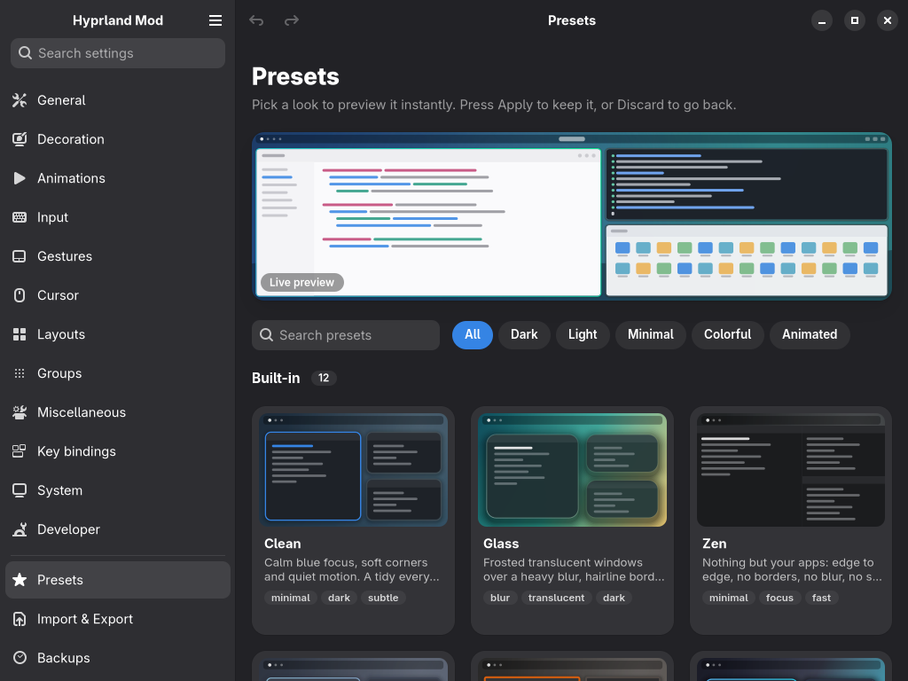
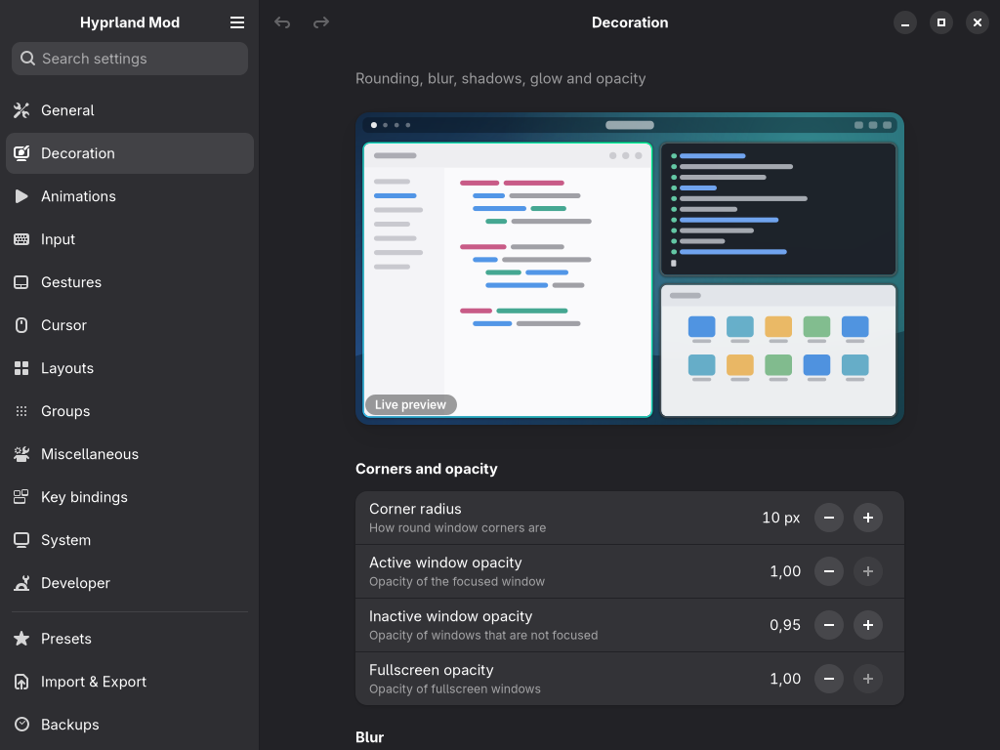
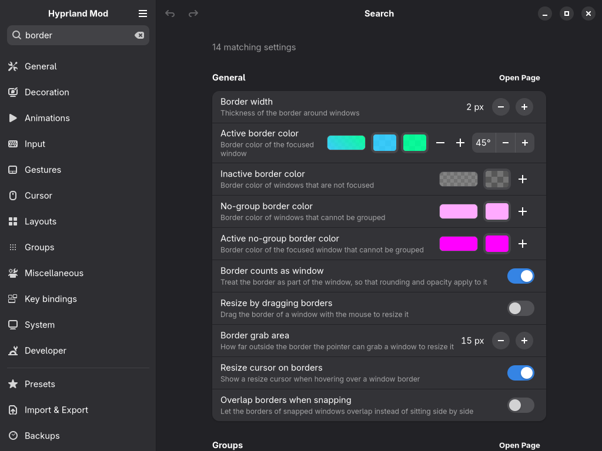
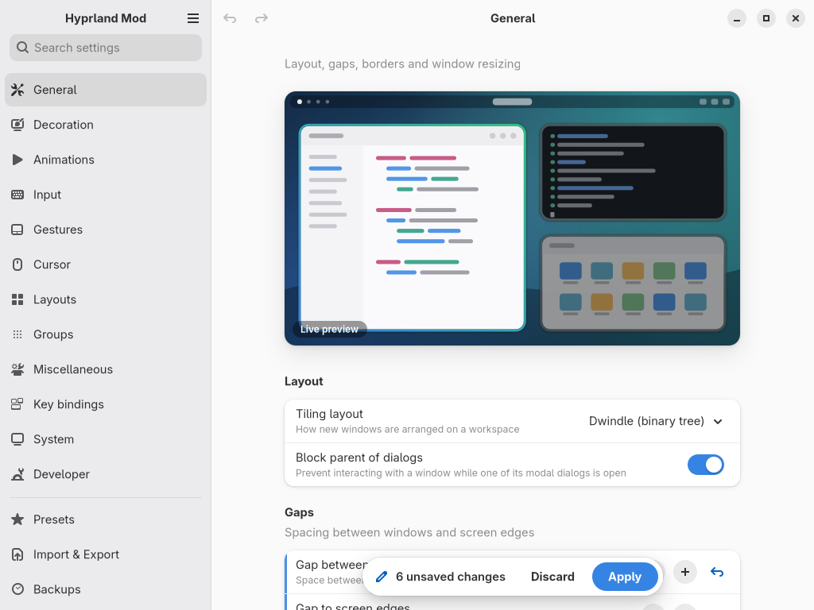
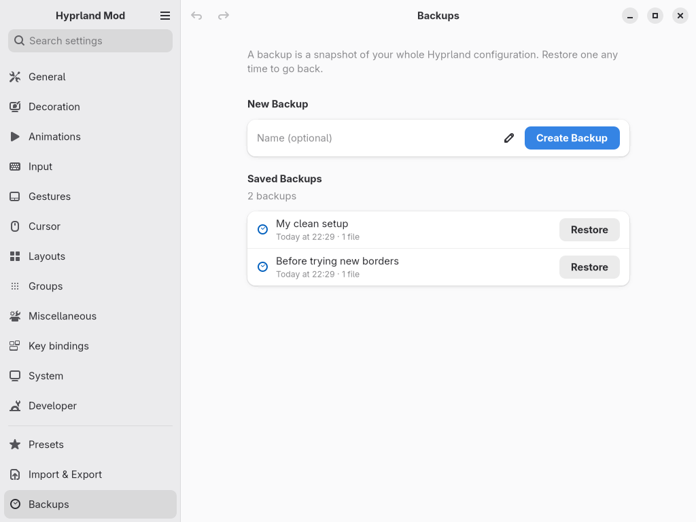
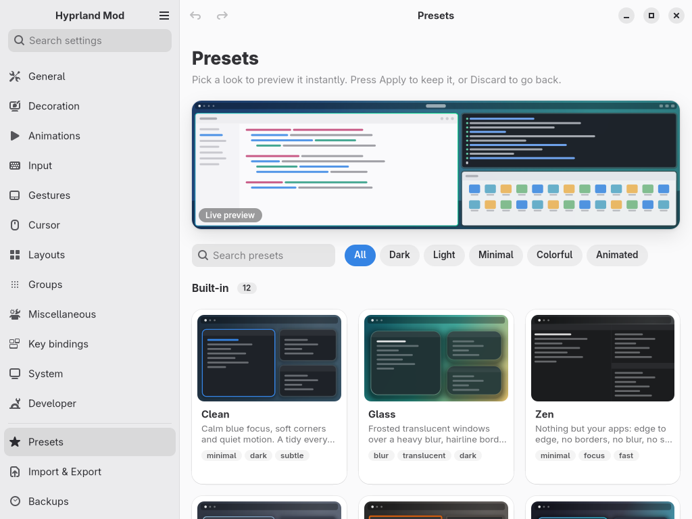
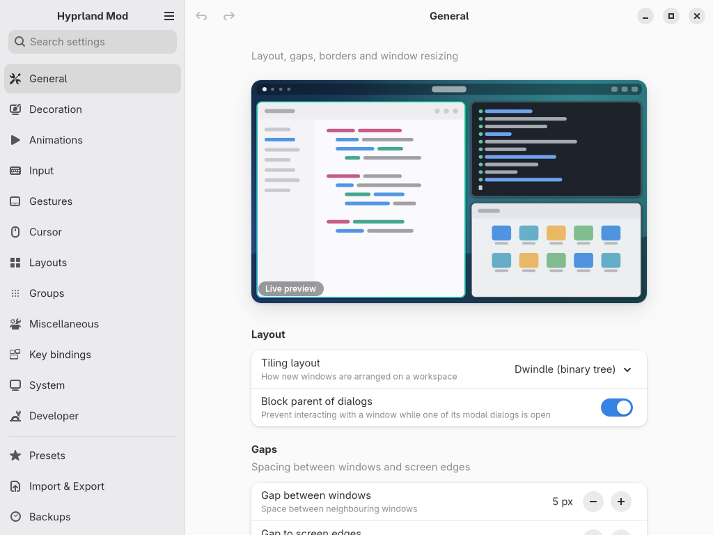
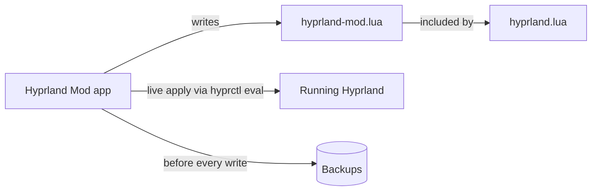

<div align="center">


# Hyprland Mod

**Every Hyprland setting and a whole rice, one click away. No config files. No terminal.**


<br>



</div>

## Why Hyprland Mod

- **Native and fast.** A real GTK4 / libadwaita app that fits your desktop, not a web page in a window.
- **Everything in one place.** 350 Hyprland settings, searchable, each with a plain-language description.
- **See it before you commit.** A live animated preview reacts as you move sliders; changes are applied to the running compositor instantly.
- **Safe by design.** It never rewrites your own config. Automatic backups, undo/redo and one-click restore are built in.
- **Rice in seconds.** Switch between presets, or share your whole setup as a single file.

## Features

- **350 settings in 12 pages** - General, Decoration, Animations, Input, Gestures, Cursor, Layouts, Groups, Miscellaneous, Key bindings, System and Developer - with global search.
- **Live animated preview** of gaps, borders, rounding, blur, shadows and animations.
- **Presets** - 12 built-in looks: Clean, Glass, Zen, Nord, Gruvbox, Tokyo Night, Everforest, Rosé Pine Dawn, Monochrome, Neon, Bubbly and Retro. Save your own, share them, import others. Imported presets are safety-checked: they can only change look-only settings and never run commands.
- **Whole-setup export / import** - move your entire configuration to another machine.
- **Safe writes** - only its own `hyprland-mod.lua` / `hyprland-mod.conf` plus a single include line.
- **Automatic backups, undo / redo and one-click restore.**
- **Lua and classic `.conf`** Hyprland configs are both supported.

## Screenshots

<table>
  <tr>
    <td></td>
    <td></td>
  </tr>
  <tr>
    <td align="center"><sub>Decoration, dark theme</sub></td>
    <td align="center"><sub>Instant search across every setting</sub></td>
  </tr>
  <tr>
    <td></td>
    <td></td>
  </tr>
  <tr>
    <td align="center"><sub>Review pending changes before applying</sub></td>
    <td align="center"><sub>Automatic backups, one-click restore</sub></td>
  </tr>
</table>

<table>
  <tr>
    <td></td>
    <td></td>
  </tr>
  <tr>
    <td align="center"><sub>Presets, light theme</sub></td>
    <td align="center"><sub>Import and export your whole setup</sub></td>
  </tr>
</table>



## Install

One command, no sudo, nothing outside your home directory:

```bash
curl -fsSL https://raw.githubusercontent.com/danielaufnahme-cmd/hyprland-mod/main/install.sh | bash
```

Then open **Hyprland Mod** from your app launcher.

Or manually:

```bash
git clone https://github.com/danielaufnahme-cmd/hyprland-mod
cd hyprland-mod
./install.sh
```

Requirements: Python 3.11+, PyGObject, GTK 4, libadwaita 1.5+. The installer checks these and prints the exact command for your distribution if something is missing:

| Distribution | Command |
| --- | --- |
| Arch | `sudo pacman -S --needed python python-gobject gtk4 libadwaita` |
| Fedora | `sudo dnf install python3 python3-gobject gtk4 libadwaita` |
| Debian / Ubuntu | `sudo apt install python3 python3-gi gir1.2-gtk-4.0 gir1.2-adw-1` |
| openSUSE | `sudo zypper install python3 python3-gobject typelib-1_0-Gtk-4_0 typelib-1_0-Adw-1` |

To upgrade, run the installer again. To try it without installing: `git clone ... && cd hyprland-mod && python3 -m hyprland_mod`.

## Uninstall

```bash
./uninstall.sh            # from the cloned repo
./uninstall.sh --purge    # also offers to delete backups and presets (asks first)
```

Your backups and presets are kept by default, and your Hyprland config is never modified. If you want to remove the include line, delete `pcall(require, "hyprland-mod")` from `hyprland.lua` (or `source = ~/.config/hypr/hyprland-mod.conf` from `hyprland.conf`).

## How it works



Hyprland Mod keeps all of its settings in its own file and adds one include line to your main config, so your hand-written config stays untouched. Changes are also pushed to the running compositor, so you see them immediately. Classic configs use `hyprland-mod.conf` and a `source =` line the same way.

## FAQ

**Will it break my config?**
No. It only writes its own file plus a single include line, and takes a backup before every change. Restoring is one click.

**Does it work with Caelestia, end-4 or other rices?**
Yes. Hyprland Mod only adds overrides on top of whatever you already have, so existing rices keep working. Both Lua and classic `.conf` configs are supported.

**Do I need to know the Hyprland config syntax?**
No. That is the point.

**Can I go back to how it was?**
Yes: undo/redo inside the app, restore any backup, or uninstall and remove the include line.

## Roadmap

- Bar builder
- Keybind editor
- Monitor layout
- Window rules
- More presets

## Contributing

Contributions are welcome. See [CONTRIBUTING.md](CONTRIBUTING.md).

## License

[MIT](LICENSE)

---

<sub>Credits: built with help from Claude (AI).</sub>
